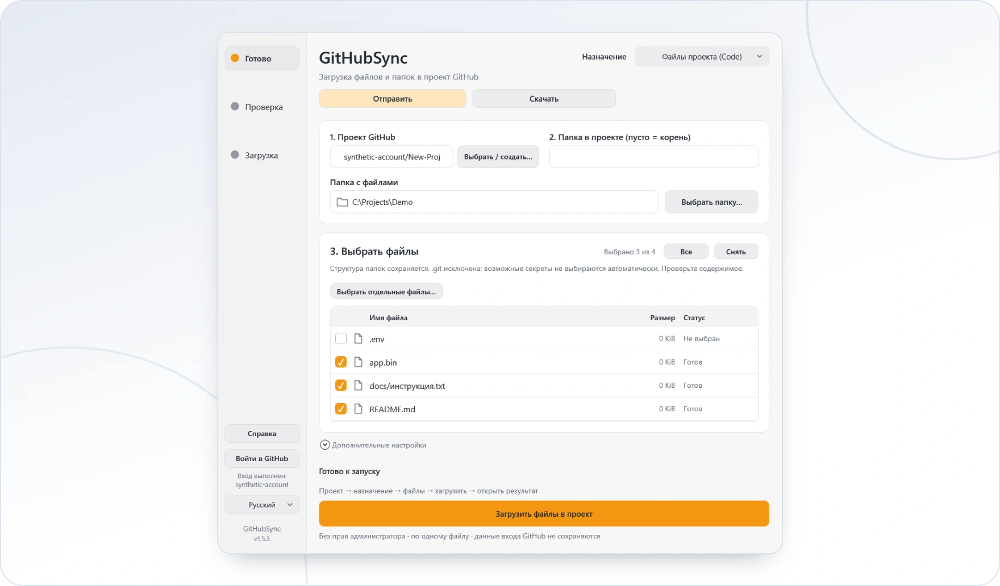

<!-- ppk-readme:head:start -->
<a href="https://popovantondev.github.io/GitHubSync/index-ru.html"><picture><source media="(prefers-color-scheme: dark)" srcset="https://raw.githubusercontent.com/popovantondev/GitHubSync/main/docs/readme/header-ru-dark.844252fb.svg"></picture></a>
<!-- ppk-readme:head:end -->

# GitHubSync

**Русский** · [Deutsch](README.md) · [English](README.en.md)

<!-- ppk-readme:body:start -->

<a href="https://github.com/popovantondev/GitHubSync/releases/tag/v1.5.3"><picture><source media="(prefers-color-scheme: dark)" srcset="https://raw.githubusercontent.com/popovantondev/GitHubSync/main/docs/readme/btn-download-ru-dark.54fe288f.svg"></picture></a>
<a href="https://popovantondev.github.io/GitHubSync/index-ru.html"><picture><source media="(prefers-color-scheme: dark)" srcset="https://raw.githubusercontent.com/popovantondev/GitHubSync/main/docs/readme/btn-website-ru-dark.7248cec3.svg"></picture></a>
<a href="https://popovantondev.github.io/GitHubSync/Guide-ru.html"><picture><source media="(prefers-color-scheme: dark)" srcset="https://raw.githubusercontent.com/popovantondev/GitHubSync/main/docs/readme/btn-guide-ru-dark.d2dd5a70.svg"></picture></a>
<a href="https://github.com/popovantondev/GitHubSync/issues/new/choose"><picture><source media="(prefers-color-scheme: dark)" srcset="https://raw.githubusercontent.com/popovantondev/GitHubSync/main/docs/readme/btn-bug-ru-dark.8c56749a.svg"></picture></a>

<a href="https://raw.githubusercontent.com/popovantondev/GitHubSync/main/docs/Ui-ru-code.png"><picture><source media="(prefers-color-scheme: dark)" srcset="https://raw.githubusercontent.com/popovantondev/GitHubSync/main/docs/readme/preview-ru-dark.2c5bceac.webp"></picture></a> 
<a href="https://raw.githubusercontent.com/popovantondev/GitHubSync/main/docs/Ui-ru-code.png">Снимок целиком</a>

<picture><source media="(prefers-color-scheme: dark)" srcset="https://raw.githubusercontent.com/popovantondev/GitHubSync/main/docs/readme/divider-dark.cab62eca.svg"></picture>
<!-- ppk-readme:body:end -->

Отправляйте файлы на GitHub и скачивайте их обратно с проверкой и докачкой. Изменения обнаруживаются автоматически, передача — только с вашего разрешения.

**Windows 10/11 · x64 · 1.5.3 · Deutsch / Русский / English**

**[Контрольная сумма SHA-256](https://github.com/popovantondev/GitHubSync/releases/download/v1.5.3/GitHubSync-1.5.3-win-x64.zip.sha256)** · **[Релиз и отдельные архивы исходников](https://github.com/popovantondev/GitHubSync/releases/tag/v1.5.3)** · **[Безопасность](SECURITY.md)**

## Первые шаги

Сверху выберите **«Отправить»** или **«Скачать»**. «Файлы проекта (Code)» — исходники и документы; «Вложения релиза» — программы и архивы. Для скачивания публичного проекта вход не обязателен: вставьте ссылку, обновите список, выберите локальную папку и файлы, затем подтвердите действие. Подробный сценарий — в [HTML-справке](docs/Guide-ru.html).

Крестик скрывает окно в трей, передача продолжается. Двойной щелчок открывает окно; «Выход» в трее завершает программу. Для скачивания доступны пауза и продолжение после проверки. Уведомления каждые 15 минут не запускают передачу автоматически.

1. Распакуйте **всю** portable-папку, откройте `GitHubSync.exe`. Установка и права администратора не нужны. Git/Git Credential Manager входят в пакет; Windows PowerShell 5.1 и .NET Framework должны быть доступны.
2. Выберите язык. Для отправки или приватного проекта нажмите «Войти в GitHub». Google, SMS и двухфакторная проверка проходят на официальной странице в браузере.
3. Выберите или создайте проект. Выберите «Файлы проекта» для вкладки Code либо «Вложения релиза» для Releases.
4. Выберите папку или файлы, проверьте список и назначение. Подтвердите отправку. Нажмите кнопку открытия результата.

Папка читается в фоне. Можно сменить папку/режим; неполный список отправить нельзя. Проект по умолчанию создаётся приватным. Публикация релиза не меняет видимость проекта.

Изображение — настоящий WPF-рендер с искусственными файлами, учебной учётной записью и путём. Личных данных в примере нет.

## Два режима

- **Файлы проекта:** вложенные папки и относительные пути сохраняются. До записи показывается «Добавится / Обновится / Без изменений». Один коммит в выбранную существующую ветку, без удаления других файлов и без force. Изменившаяся ветка или защищённая ветка останавливает отправку.
- **Вложения релиза:** выберите/создайте черновик. Включённый флажок «Опубликовать после загрузки» означает загрузку и публикацию после подтверждения всех вложений. Выключенный — сохранение черновика. Можно опубликовать позже отдельно. После публикации доступны ссылки на релиз и вложения.

## Ограничения и данные

Неизменённые файлы не создают пустой коммит. Code не принимает файлы больше 100 MiB; выберите «Отправить → Вложения релиза». Git LFS не настраивается. `.git` и ссылки исключаются. Возможные секреты по именам не выбираются автоматически, но это **не проверка содержимого на все секреты**. `.gitignore` автоматически не применяется: просмотрите выбор самостоятельно. Уже опубликованные релизы не редактируются.

Приложение хранит `config.json` и `ui-settings.json` рядом с EXE, ошибки — в локальном журнале. Токены в эти файлы не записываются; входом управляет Git Credential Manager. Настройки могут содержать имена файлов, имя аккаунта и локальные пути: не публикуйте их. Репозиторий исходников исключает папки `artifacts/`, `runtime/`, настройки, журналы и ключи.

## Проверка, выпуск и права

В версии 1.5.3 отправка в Code переведена с большого base64-запроса на встроенный Git: один коммит, без удаления остальных файлов и без force. Git готовит временный снимок ветки, не изменяя выбранную локальную папку. Прогресс объектов Git не означает подтверждения файлов; успех показывается после проверки коммита на GitHub. Трей-меню больше не пересоздаётся каждую секунду. Проверки и отдельно разрешённая приёмка искусственных файлов в закрытом TEST описаны в [отчёте 1.5.3](docs/VERIFICATION-1.5.3.md). Другие компьютеры и физическое переключение DPI не проверены.

Выпускной архив: `GitHubSync-1.5.3-win-x64.zip`, рядом файл `.sha256`. Сверьте SHA-256 перед распаковкой. Инструкции сборки и структура — в [CONTRIBUTING](CONTRIBUTING.md), подробная справка открывается офлайн. Лицензия текущих исходников — [MIT](LICENSE); сторонние компоненты имеют [собственные лицензии](THIRD_PARTY.md).
